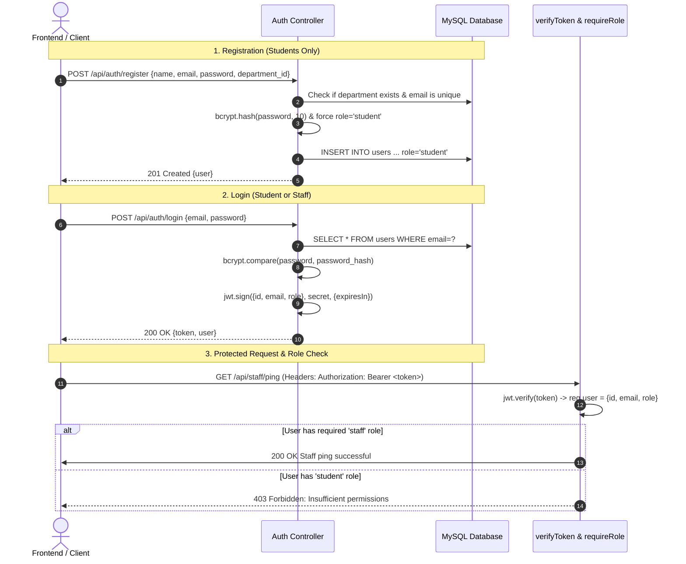

# Academic Resource Sharing Hub (College Micro Project)

A role-based SaaS web application designed for colleges to centralize, discover, verify, and share academic resources (lecture notes, question banks, previous-year question papers, lab manuals, and more).

---

## 1. Project Overview & Architecture

### Target Users & Roles
- **Student**: Discovers, searches, bookmarks, downloads academic resources, requests missing materials, and contributes new resources for staff review. Students self-register via the portal.
- **Staff**: Department faculty / administrators who verify student contributions, approve/reject submissions with feedback, upload official course materials, respond to student requests, and monitor repository statistics. Staff accounts are seeded or created administratively (public registration is disabled).

### Tech Stack
- **Backend**: Node.js + Express.js (RESTful APIs)
- **Database**: MySQL 8 (Mandatory, using `mysql2/promise` connection pool, no ORM)
- **Authentication**: JSON Web Token (JWT) + bcrypt password hashing
- **Security & Validation**: Helmet, CORS, parameterized SQL queries, express-validator
- **Frontend** *(Upcoming Milestone)*: React (Vite) + Tailwind CSS

---

## 2. Project Directory Structure

```text
dd22/
├── backend/
│   ├── sql/
│   │   ├── schema.sql              # MySQL DDL for all 9 tables + indexes
│   │   └── seed.sql                # Departments, subjects, resource types, & demo staff
│   ├── src/
│   │   ├── config/
│   │   │   ├── db.js               # mysql2/promise connection pool
│   │   │   └── env.js              # Environment variable loader & defaults
│   │   ├── controllers/
│   │   │   ├── authController.js   # register, login, getProfile, updateProfile
│   │   │   └── staffController.js  # Staff route handlers (RBAC demonstration)
│   │   ├── middleware/
│   │   │   ├── auth.js             # verifyToken & requireRole RBAC middleware
│   │   │   ├── errorHandler.js     # 404 handler and centralized JSON error handler
│   │   │   └── validate.js         # express-validator request validation chains
│   │   ├── routes/
│   │   │   ├── authRoutes.js       # /api/auth routes
│   │   │   └── staffRoutes.js      # /api/staff routes (RBAC protected)
│   │   ├── utils/
│   │   │   └── hashPassword.js     # CLI tool to generate bcrypt hashes
│   │   ├── app.js                  # Express app & middleware composition
│   │   └── server.js               # HTTP server listener & DB connection check
│   ├── .env.example                # Environment variable template
│   └── package.json                # Backend dependencies and scripts
├── frontend/                       # Placeholder for upcoming React application
├── .gitignore                      # Git ignore rules (.env, node_modules, uploads)
└── README.md                       # Setup guide, API test commands & architecture docs
```

---

## 3. Database Setup & Initialization

### Database Schema Summary
The database consists of 9 normalized relational tables:
1. `departments` (`id`, `name UNIQUE`, `created_at`)
2. `users` (`id`, `name`, `email UNIQUE`, `password_hash`, `role ENUM('student','staff')`, `department_id`, `created_at`)
3. `subjects` (`id`, `name`, `department_id`, `year`, `semester`, `created_at`)
4. `resource_types` (`id`, `name UNIQUE`, `created_at`)
5. `resources` (`id`, `title`, `description`, `subject_id`, `resource_type_id`, `uploaded_by`, `file_path`, `academic_year`, `status ENUM('PENDING','UNDER_REVIEW','VERIFIED','PUBLISHED','REJECTED','ARCHIVED')`, `created_at`)
   - Compound index on `(subject_id, resource_type_id, status, academic_year)`
   - FULLTEXT index on `(title, description)`
6. `resource_requests` (`id`, `student_id`, `subject_id`, `title`, `description`, `status ENUM('PENDING','COMPLETED','CLOSED')`, `staff_remarks`, `created_at`)
7. `bookmarks` (`id`, `student_id`, `resource_id`, `created_at`, `UNIQUE(student_id, resource_id)`)
8. `resource_downloads` (`id`, `student_id`, `resource_id`, `downloaded_at`)
9. `resource_reviews` (`id`, `resource_id`, `staff_id`, `status ENUM(...)`, `remarks`, `reviewed_at`)

### Step-by-Step MySQL Commands
Open PowerShell / Terminal and run:

```bash
# 1. Login to MySQL
mysql -u root -p

# 2. Inside MySQL CLI, run the schema and seed scripts:
source d:/dd22/backend/sql/schema.sql;
source d:/dd22/backend/sql/seed.sql;
```

Alternatively, from standard Command Prompt / Terminal:
```bash
# On Windows / Linux:
mysql -u root -p < backend/sql/schema.sql
mysql -u root -p < backend/sql/seed.sql
```

### Initial Seed Data Provided
- **3 Departments**:
  - `1`: Artificial Intelligence and Data Science
  - `2`: Computer Science and Engineering
  - `3`: Information Technology
- **8 Resource Types**: Lecture Notes, Question Paper, Question Bank, Lab Manual, Study Materials, PowerPoint Presentations, Syllabus and Course Documents, Project Guidelines.
- **5 Subjects**: DBMS, Machine Learning, Operating Systems, OOP, Data Structures.
- **1 Demo Staff User**:
  - Email: `staff@college.edu`
  - Password: `Staff@123`
  - Role: `staff`
  - Department: AI&DS

---

## 4. Backend Setup & Running

### Step 1: Install Dependencies
```bash
cd backend
npm install
```

### Step 2: Configure Environment Variables
Copy `.env.example` to `.env` in the `backend/` folder:
```bash
cp .env.example .env
```
Update your database credentials in `backend/.env`:
```ini
PORT=5000
NODE_ENV=development
CLIENT_ORIGIN=http://localhost:5173

DB_HOST=localhost
DB_PORT=3306
DB_USER=root
DB_PASSWORD=your_actual_mysql_password
DB_NAME=academic_resource_hub
DB_SSL=false

JWT_SECRET=super_secret_jwt_key_second_year_project_2026
JWT_EXPIRES_IN=24h
```

### Step 3: Start the Backend Server
```bash
# Development mode (with auto-reload on file changes):
npm run dev

# Or Production mode:
npm start
```
The server will boot on `http://localhost:5000`.

---

## 5. Password Hashing Utility

To generate a new bcrypt hash for database seeding or manual credentials:
```bash
cd backend
node src/utils/hashPassword.js [your_password]

# Example:
node src/utils/hashPassword.js MyStaffPass@2026
```

---

## 6. Authentication Flow & RBAC Architecture



### Key Security Design Choices:
1. **Server-Enforced Role**: The registration route strictly hardcodes `role = 'student'`. Even if a client includes `"role": "staff"` in their JSON payload, it is completely ignored.
2. **Password Security**: Passwords are never stored in plaintext. They are salted and hashed using bcrypt (10 rounds). The `password_hash` column is explicitly excluded from all API responses.
3. **Stateless JWT Authorization**: Requests to protected routes supply `Authorization: Bearer <token>`. The `verifyToken` middleware decodes the token and attaches `req.user` (`id`, `email`, `role`).
4. **Role-Based Access Control (RBAC)**: The `requireRole(...roles)` middleware inspects `req.user.role`. If a student attempts to access a staff-only route, a 403 Forbidden is immediately returned.
5. **SQL Injection Defense**: Every database operation uses parameterized queries (`?` placeholders via `mysql2/promise`).

---

## 7. API Testing Guide (cURL & PowerShell)

### A. Health Check
```bash
curl -X GET http://localhost:5000/api/health
```

---

### B. Register a Student Account (`POST /api/auth/register`)
```bash
curl -X POST http://localhost:5000/api/auth/register \
  -H "Content-Type: application/json" \
  -d '{
    "name": "Arun Kumar",
    "email": "arun.student@college.edu",
    "password": "Password@123",
    "department_id": 1
  }'
```

*Response (201 Created):*
```json
{
  "success": true,
  "message": "Student account registered successfully.",
  "data": {
    "user": {
      "id": 2,
      "name": "Arun Kumar",
      "email": "arun.student@college.edu",
      "role": "student",
      "department_id": 1,
      "department_name": "Artificial Intelligence and Data Science"
    }
  }
}
```

---

### C. Log In as the Student (`POST /api/auth/login`)
```bash
curl -X POST http://localhost:5000/api/auth/login \
  -H "Content-Type: application/json" \
  -d '{
    "email": "arun.student@college.edu",
    "password": "Password@123"
  }'
```
*Save the returned `token` as `STUDENT_TOKEN`.*

---

### D. Log In as the Seed Staff Member (`POST /api/auth/login`)
```bash
curl -X POST http://localhost:5000/api/auth/login \
  -H "Content-Type: application/json" \
  -d '{
    "email": "staff@college.edu",
    "password": "Staff@123"
  }'
```
*Save the returned `token` as `STAFF_TOKEN`.*

---

### E. Get Current User Profile (`GET /api/auth/me`)
```bash
curl -X GET http://localhost:5000/api/auth/me \
  -H "Authorization: Bearer <STUDENT_TOKEN>"
```

---

### F. Update Profile (`PUT /api/auth/profile`)
```bash
curl -X PUT http://localhost:5000/api/auth/profile \
  -H "Authorization: Bearer <STUDENT_TOKEN>" \
  -H "Content-Type: application/json" \
  -d '{
    "name": "Arun K."
  }'
```

---

### G. Test Staff Route Protection (`GET /api/staff/ping`)

#### 1. Student Attempt (Should fail with 403 Forbidden):
```bash
curl -X GET http://localhost:5000/api/staff/ping \
  -H "Authorization: Bearer <STUDENT_TOKEN>"
```
*Expected Response:*
```json
{
  "success": false,
  "message": "Forbidden: Access requires one of [staff] role. Current role: 'student'"
}
```

#### 2. Staff Attempt (Should succeed with 200 OK):
```bash
curl -X GET http://localhost:5000/api/staff/ping \
  -H "Authorization: Bearer <STAFF_TOKEN>"
```
*Expected Response:*
```json
{
  "success": true,
  "message": "Staff route ping successful. Welcome, staff@college.edu!",
  "data": {
    "staff_id": 1,
    "role": "staff",
    "timestamp": "..."
  }
}
```
